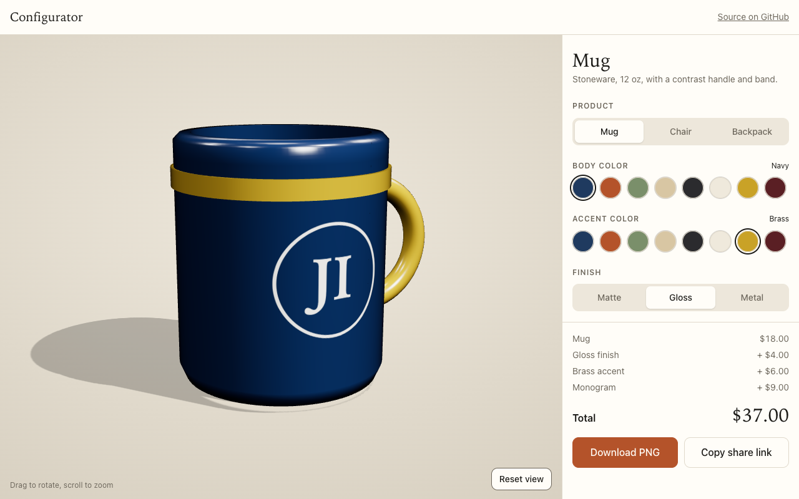

# 3D Product Configurator

A browser-based product configurator built with Three.js and plain ES modules, with no bundler and no model files. Pick a mug, chair or backpack, change the colors and finish, add a monogram, watch the price update, and share the exact configuration as a link.

Live demo: https://inmanjeffrey89-cell.github.io/product-configurator-3d/



## What it does

- Three products built in code from primitives, lathe profiles and extruded shapes
- Body color, accent color and finish (matte, gloss, metal)
- Monogram decal drawn on a canvas texture and projected onto the surface
- Live price with a breakdown, driven by `src/pricing.json`
- Share link: the configuration lives in the URL hash and restores on load
- Download the current view as a PNG
- Orbit, zoom, auto-rotate and reset view
- Side panel on desktop, bottom sheet on phones
- Light and dark mode follow the system setting
- Every control has a label and works from the keyboard

## Run it locally

ES modules need http, so any static server will do:

```
python3 -m http.server 8080
```

Then open http://localhost:8080. Three.js loads from jsDelivr, pinned to 0.160.0 in the import map in `index.html`.

## Add a product

1. In `src/products.js`, write a `buildX()` function that returns `{ group, decal }`. Tag each mesh with `userData.part` set to `body` or `accent` so it picks up the right material. `decal` names the mesh the monogram projects onto, the position on it, and the size.
2. Add an entry to `PRODUCTS` with an id, name, blurb, the builder and a default camera view.
3. Add the same id under `products` in `src/pricing.json` with a base price and a surcharge per finish.

The panel reads both files, so nothing else changes.

## Hook it to a cart

`window.configurator` exposes `getState()`, `setState(patch)`, `subscribe(fn)` and `snapshot()`, which resolves to a PNG blob. A store integration can subscribe to changes and send the state along with the add-to-cart request.

## Tests

`test/unit.spec.mjs` covers the pure helpers (hash encode and decode, monogram sanitizing, pricing) with no browser. `test/e2e.spec.mjs` runs on Node's built-in test runner with Playwright. It starts a local server, opens the app in headless Chromium and checks real WebGL draw calls, the pricing table, hash restore, the share link and its no-clipboard fallback, the PNG download, the chair geometry and both layouts. Screenshots land in `test/out/`.

```
npm install
npm test
```

To run the same suite against a deployed copy: `BASE_URL=https://example.com npm test`. If Playwright is installed somewhere else, point at it with `PLAYWRIGHT_MODULE=/path/to/node_modules/playwright`.

Headless Chromium needed `--use-angle=swiftshader --enable-unsafe-swiftshader` for WebGL on macOS; the spec passes those flags.

## License

MIT, Jeffrey Inman.
